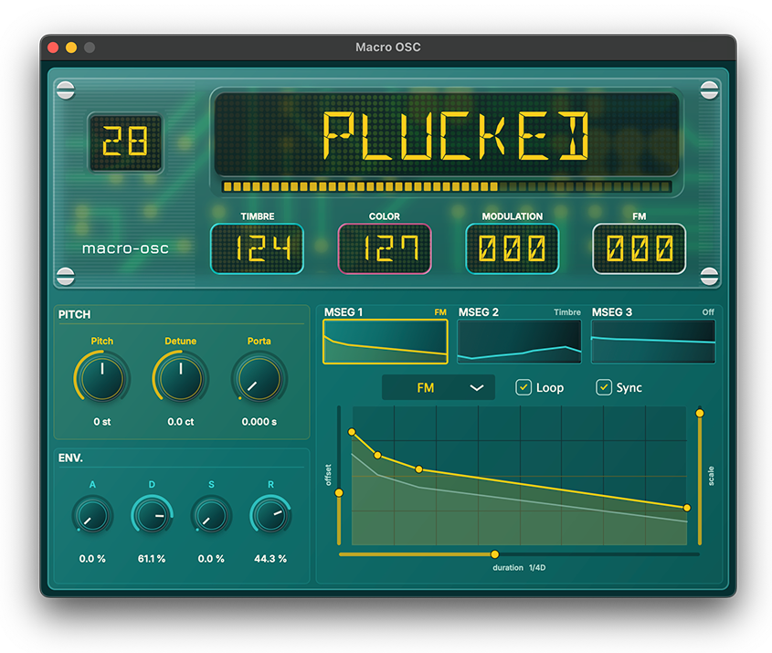

# Macro OSC

A free, open-source polyphonic synthesizer built on the Mutable Instruments Braids macro oscillator. VST3 plugin and standalone app.

Its sibling, [Macro OSC II](https://github.com/Reece4000/macro_oscillator_ii), is built on Mutable Instruments Plaits. The two share their layout, controls, effects and modulation; Macro OSC II inverts Macro OSC's colour scheme.

[](https://github.com/Reece4000/macro_oscillator/releases/latest)
[](LICENSE)



## Features

- All 47 Braids oscillator models, with Timbre, Color, Modulation and FM.
- Model selection from a menu, arrow buttons, or a map of all models grouped by family.
- A waveform display of the selected model at its current Timbre and Color.
- Poly (1–8 voices), mono and legato modes; constant-time glide; pitch, detune and an ADSR envelope.
- Per-voice distortion: 19 modes, 13 of them adapted from Airwindows, with Amount, Mix and Output.
- Per-voice low-, band- and high-pass filter with a draggable response curve.
- Three MSEG modulators:
  - Drawable curves with loop and tempo sync.
  - Scale, offset, rate and random controls.
  - 14 destinations, including model, pitch, level and every filter and distortion parameter.
- MSEG random moves each point by its own amount, redrawn for every note and every loop cycle. A curve can be reduced to one point for a fixed per-note offset.
- Presets, output volume, a resizable interface (75–150%) and tooltips.
- Per-voice headroom, resonance gain compensation and an output limiter.

## Download

Builds for macOS on Apple Silicon are on the [releases page](https://github.com/Reece4000/macro_oscillator/releases/latest).

- **VST3:** unzip `MacroOSC-macOS-arm64-v0.2.0-vst3.zip` and copy `Macro OSC.vst3` to `~/Library/Audio/Plug-Ins/VST3/`.
- **Standalone:** unzip `MacroOSC-macOS-arm64-v0.2.0-standalone.zip` and open `Macro OSC.app`. Audio and MIDI devices are set from the ☰ menu.

The builds are ad-hoc signed, so macOS may block them on first launch. Allow them under **System Settings → Privacy & Security**, or clear the quarantine flag:

```sh
xattr -dr com.apple.quarantine ~/Library/Audio/Plug-Ins/VST3/"Macro OSC.vst3" "/path/to/Macro OSC.app"
```

For other platforms, build from source (below).

## Presets

[`Presets/`](Presets) contains four example presets, also available as `MacroOSC-presets.zip` on the releases page. Copy the `.mosc` files to `~/Documents/Macro OSC/Presets` and they appear under **☰ → Presets**.

| Preset | Model | Notes |
|---|---|---|
| Attack Bass | SINE/TRI | Mono, two octaves down; Grit distortion; tempo-synced filter envelope, modulated drive, FM on the attack. |
| Airy Bursts | FLUTED | Tape distortion; looping timbre and filter modulation with random; a short FM burst on each note. |
| Sad Boi | BUZZ | Slow attack and long release; Stack distortion; tempo-synced timbre and filter modulation with random. |
| Unstable Tines | DRUM | Long decay; Heat distortion; slight random pitch drift and looping filter modulation. |

## Usage

- Each model maps Timbre and Color differently. For example, on PLUCKED they set decay and pluck position, and on the FM models the modulation index and ratio.
- Sliders respond to dragging in any direction and to the arrow keys; Shift gives fine control, and double-click or Backspace resets.
- In the MSEG editor:
  - Click to add a point, drag to move one, and right-click to remove one.
  - The dashed line is the curve after scale and offset.
  - Shaded boxes show the range random can move each point.

## Build from source

Macro OSC is a CMake project using [JUCE](https://juce.com):

```sh
cmake -S . -B build -DJUCE_DIR=/path/to/JUCE
cmake --build build --config Release
```

Run the tests with:

```sh
cmake --build build --target MacroOscDspTests MacroOscVst3Tests
ctest --test-dir build --output-on-failure
```

The tests cover:
- all 47 Braids models, including deterministic initialization and strike models (plucked, bowed, bell, drum);
- host block sizes at 44.1, 48 and 96 kHz;
- every distortion mode, filter response and effect modulation;
- MIDI timing, voice allocation, sustain, glide timing, and mono and legato;
- output safety, MSEG random, presets and editor sizing.

The VST3 test loads the built bundle and plays it through the plugin interface.

## Technical notes

Each voice runs a Braids macro oscillator, then the amplitude envelope, then distortion and filter. Both effects default to Off. Distortion Output affects only the wet signal, with unity gain at 50%. Filter Frequency spans 20–20,000 Hz and Q spans 1–30, and frequency modulation uses a logarithmic range. Effect type changes crossfade, and continuous controls are smoothed. The distortion and filter displays show base settings; MSEG modulation is applied per voice.

In poly mode, voices rotate through free slots. Fresh notes reset oscillator history, MIDI is handled at exact sample positions, and stealing a busy voice crossfades it out over 5 ms. Mono and legato play the newest key and return to keys still held. Mono retriggers the envelope; legato does not. Glide takes its set time regardless of interval, starting from the current pitch.

Each voice keeps about 9 dB of headroom, and filter resonance is gain-compensated. A limiter and soft clipper at the output leave audio below −1 dBFS unchanged.

When using VCV Host, pitch and gate must arrive together. If V/OCT passes through a quantizer but GATE connects directly, Host can trigger the previous pitch on that polyphonic channel. Put a VCV VCA at 100% gain in the gate path (signal input, CV unpatched), or connect both signals directly. See the [Rack timing reproduction](Tests/Diagnostics/RackCvTiming.md).

## Credits

- [Mutable Instruments Braids](https://pichenettes.github.io/mutable-instruments-documentation/modules/braids/) by Émilie Gillet: oscillator DSP (MIT).
- [Airwindows](https://www.airwindows.com) by Chris Johnson: 13 distortion algorithms (MIT).
- [JUCE](https://juce.com): plugin framework.
- [Geist](https://vercel.com/font) and [DSEG](https://www.keshikan.net/fonts-e.html): fonts (SIL OFL).

## License

Except where noted, Macro OSC source code and first-party assets are licensed under the GNU Affero General Public License version 3 or later; see [`LICENSE`](LICENSE). Third-party notices for Braids/stmlib, Airwindows, the fonts and JUCE are in [`THIRD_PARTY_NOTICES.md`](THIRD_PARTY_NOTICES.md).
